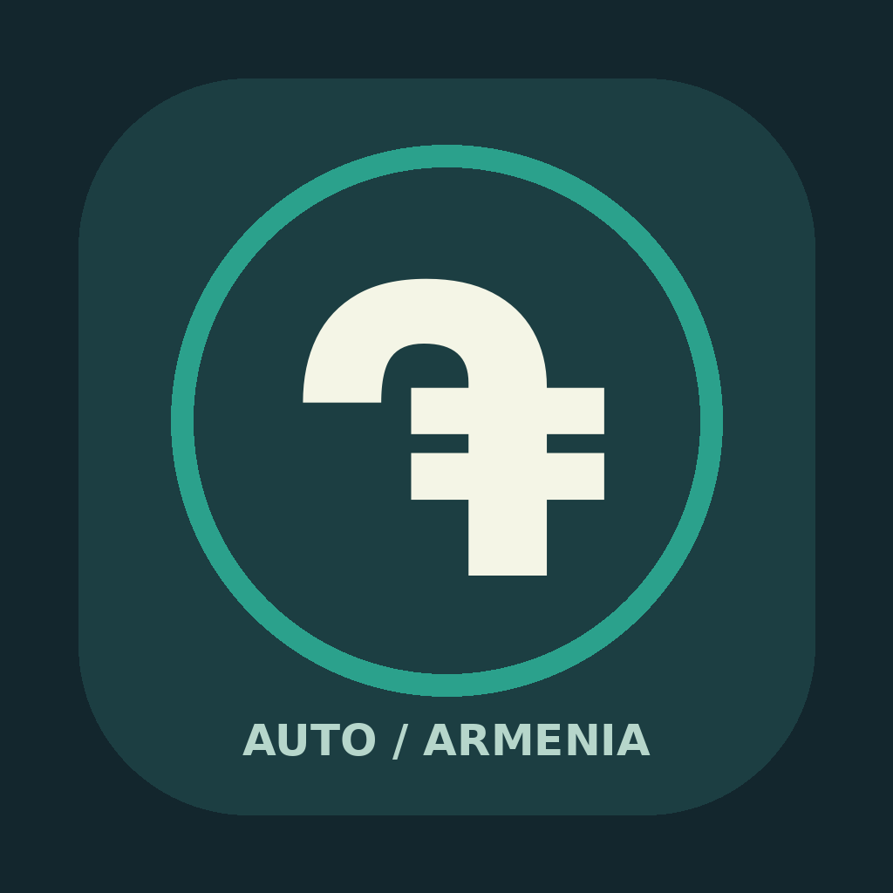
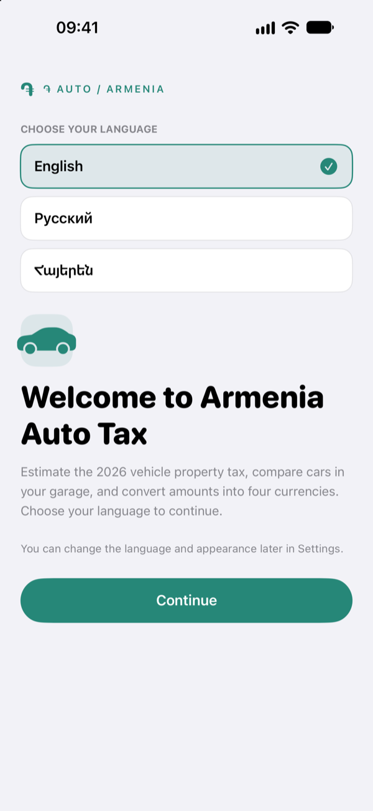
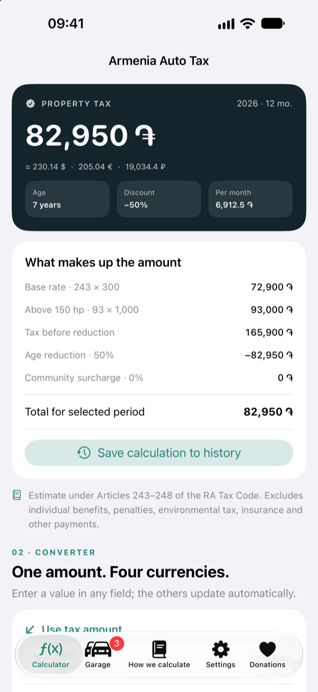
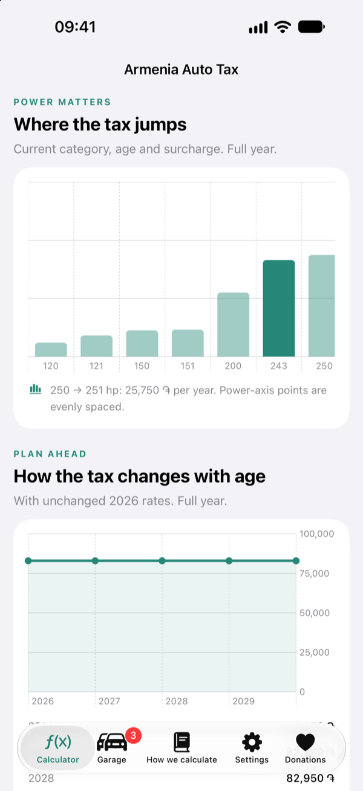
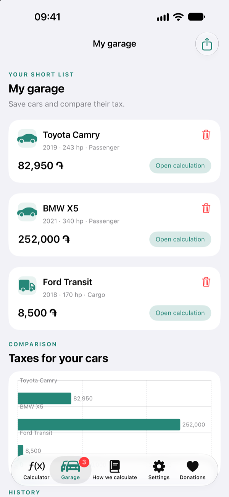
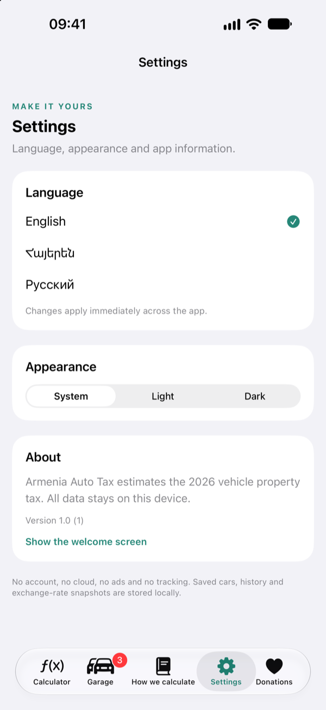

<p align="center">
  
</p>

<h1 align="center">Armenia Auto Tax</h1>

<p align="center">
  A native, offline-first iOS calculator for Armenia's 2026 vehicle property tax.
</p>

<p align="center">
  
  
  
  
</p>

---

Armenia Auto Tax turns the 2026 Armenian vehicle property tax rules into a clear, fast iPhone experience. It estimates the annual and period tax, explains every part of the calculation, converts the result into four currencies, compares vehicles in a local garage and keeps a private calculation history.

The app is fully on-device. There is no account, no backend, no advertising and no tracking.

## Features

- **2026 tax calculator** for passenger cars, buses, cargo/cargo-passenger vehicles, motorcycles and ATVs/snowmobiles/watercraft.
- **The real rate bands**: 200/300/500 AMD per hp for passenger cars, the extra 1,000 AMD above 150 hp, 100/200 AMD for buses and cargo, 40 AMD for motorcycles and 150 AMD for other vehicles.
- **Age reduction** of 10% per year from the third tax year following manufacture, capped at 50%, plus the 20th-year cargo exemption.
- **Four-currency converter** for AMD, USD, EUR and RUB with official Central Bank of Armenia rates, cached offline values and manual overrides.
- **Swift Charts** for horsepower jumps and a 2026–2030 forecast using the fixed 2026 schedule.
- **Garage and history** with local JSON persistence, one-tap reload, deletion and JSON export through the native share sheet.
- **English, Russian and Armenian** with English as the default. The language can be changed during onboarding or later in Settings.
- **Appearance control**: system, light or dark.
- **Optional tips** through StoreKit 2 consumables. Donations unlock nothing; every feature is always available.

## Screenshots

| Welcome | Calculator |
|:---:|:---:|
|  |  |

| Charts and converter | Garage | Settings |
|:---:|:---:|:---:|
|  |  |  |

## Requirements

- Xcode 16 or newer
- iOS 17 or newer
- iPhone (the app is designed for iPhone; iPad runs it in compatibility mode)
- No CocoaPods, Carthage, Swift Package dependencies, server, account or API key

## Run the app

```sh
git clone https://github.com/Dronnn/ArmeniaAutoTax.git
cd ArmeniaAutoTax
open ArmeniaAutoTax.xcodeproj
```

Select the **ArmeniaAutoTax** scheme and an iPhone simulator running iOS 17 or newer, then press **⌘R**.

To install on a physical device, choose your Apple Developer team under **Signing & Capabilities**. The bundle identifier is `com.mrmaier.armeniaautotax`; change it if it conflicts with an existing app.

## Tests

The tax engine is also exposed as a small Swift Package, so the core formulas can be tested on macOS without Xcode:

```sh
swift test
```

The full Xcode suite includes unit tests and UI tests for onboarding, the calculator, language switching, the garage and donations:

```sh
xcodebuild \
  -project ArmeniaAutoTax.xcodeproj \
  -scheme ArmeniaAutoTax \
  -destination 'platform=iOS Simulator,name=iPhone 17' \
  test
```

Test coverage includes:

- every tax-rate boundary and vehicle category;
- age reduction and cargo-exemption boundaries;
- municipal surcharges, partial-year proration and clamping;
- chart data and category-specific rate jumps;
- the Central Bank SOAP parser, cached rates and manual overrides;
- local persistence, garage upsert/delete, history and JSON export;
- number formatting, decimal input across locales and plural forms;
- all three localizations and the StoreKit product catalog;
- UI flows for onboarding, calculator updates, settings, garage add/open/delete/persistence and the donations screen.

## Project layout

```text
ArmeniaAutoTax/
  ArmeniaAutoTaxApp.swift     App entry, tabs, onboarding hand-off
  Core/                       Vehicle model, tax engine, chart data
  Services/                   Localization, formatting, CBA rates, storage, StoreKit
  Views/                      Calculator, converter, charts, garage, rules, settings, donations
  Resources/                  Assets, launch screen, String Catalog
Tests/
  TaxCoreTests/               Cross-platform Swift Package tests
  iOSTests/                   Xcode unit tests
  iOSUITests/                 Xcode UI tests
Configuration/
  ArmeniaAutoTax.storekit     Local StoreKit configuration for tips
Package.swift                 Standalone test harness for the tax engine
```

## Donations

The Donations tab uses six optional consumable tips with StoreKit 2. The included `Configuration/ArmeniaAutoTax.storekit` file powers local Debug runs. For App Store distribution, create six consumable In-App Purchases in App Store Connect with these product IDs:

```
com.mrmaier.armeniaautotax.tip.small
com.mrmaier.armeniaautotax.tip.medium
com.mrmaier.armeniaautotax.tip.large
com.mrmaier.armeniaautotax.tip.generous
com.mrmaier.armeniaautotax.tip.patron
com.mrmaier.armeniaautotax.tip.extraordinary
```

Donations are optional. No feature is locked behind a purchase.

## Tax rules and limitations

The calculator uses the 2026 rules from the Republic of Armenia Tax Code, Articles 242–248:

- Passenger cars under 10 seats: 200 AMD/hp up to 120 hp; 300 AMD/hp for 121–250 hp; 500 AMD/hp for 251+ hp; plus 1,000 AMD for every hp above 150.
- Buses and cargo/cargo-passenger vehicles: 100 AMD/hp up to 200 hp; 200 AMD/hp from 201 hp.
- Motorcycles: 40 AMD/hp. Watercraft, snowmobiles and ATVs: 150 AMD/hp.
- The year of manufacture and the next two tax years are taxed at 100%. From the third following year the tax decreases by 10 percentage points per year, up to 50%.
- Cargo and cargo-passenger vehicles are exempt from the 20th tax year following manufacture.
- A local community may increase rates by up to 10%. The calculator defaults to 0%.
- Partial-year amounts are proportional to the number of liability months. The exact month count depends on the ownership registration and termination dates under Article 246; the input is an estimate.
- Power is entered as integer horsepower. The statutory 1.36 kW-to-horsepower coefficient is documented but kW input is not implemented.
- Individual benefits, shared ownership, penalties, environmental tax, insurance, customs duty and official billing are outside the scope of this calculator.

This is an estimate, not an official tax assessment. The final amount is determined by the relevant local tax authority.

Official sources:

- [Republic of Armenia Tax Code, Articles 242–248](https://www.arlis.am/en/acts/205620)
- [Central Bank of Armenia exchange-rate API](https://www.cba.am/en/exchange-rates-retrieval)
- [Hartak: individual taxes](https://english.hartak.am/guides/individual-taxes/)

## Privacy

Saved vehicles, history and exchange-rate snapshots stay on the device. The app has no account, cloud sync, analytics, advertising or tracking. Network access is used only to refresh Central Bank rates and to open official reference links.

## Author

Built and maintained by [Andrew Maier](https://github.com/Dronnn).
