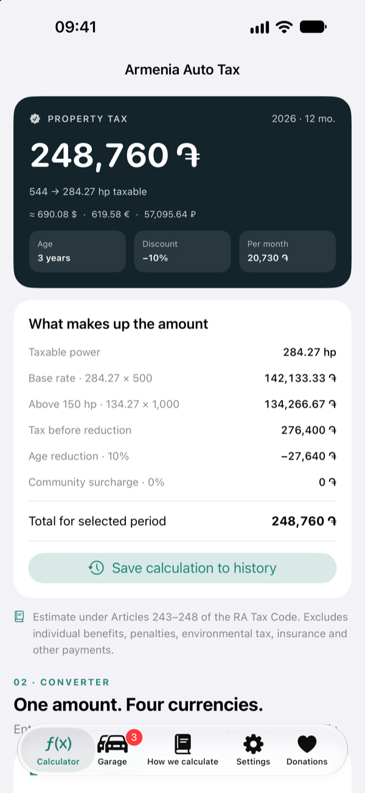
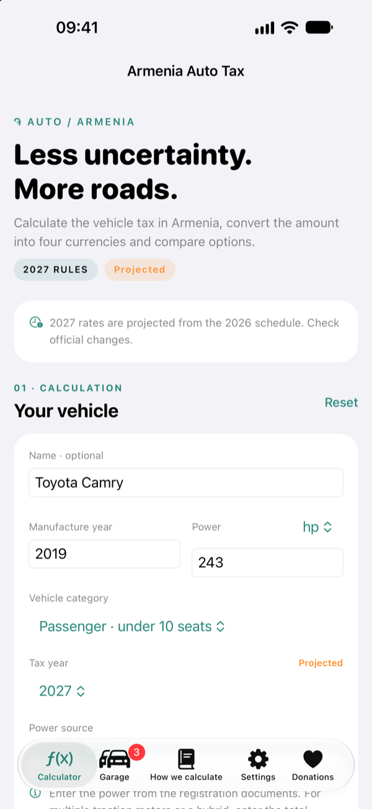

<p align="center">
  
</p>

<h1 align="center">Armenia Auto Tax</h1>

<p align="center">
  A native, offline-first iOS calculator for Armenia's 2026 vehicle property tax.
</p>

<p align="center">
  
  
  
  
</p>

---

Armenia Auto Tax turns the Armenian vehicle property tax rules into a clear, fast iPhone and iPad experience. It estimates the annual and period tax, explains every part of the calculation, converts the result into four currencies, compares vehicles in a local garage and keeps a private calculation history.

The app is fully on-device. There is no account, no backend, no advertising and no tracking.

## Features

- **Verified 2026 calculator** for passenger cars, buses, cargo/cargo-passenger vehicles, motorcycles and ATVs/snowmobiles/watercraft. 2027–2030 are projected from the 2026 schedule and clearly marked.
- **Tax year picker** from 2026 to 2030, with a visible verified/projected status and a suggestion when a new calendar year starts.
- **The real rate bands**: 200/300/500 AMD per hp for passenger cars, the extra 1,000 AMD above 150 hp, 100/200 AMD for buses and cargo, 40 AMD for motorcycles and 150 AMD for other vehicles.
- **EV power rule**: choose fuel/hybrid, electric power from the EAEU e-passport, or raw electric motor power. Raw power uses the 2026 1.5 / 2.5 rule; e-passport power is used as is.
- **Power in hp or kW** with the statutory 1.36 coefficient and decimal input.
- **Age reduction** of 10% per year from the third tax year following manufacture, capped at 50%, plus the 20th-year cargo exemption.
- **Ownership dates** can produce the Article 246 liability months: the acquisition month is excluded, the disposal month is included, and a December acquisition produces zero months in that tax year.
- **Editable rate schedules**: inspect the official bands, override them per tax year, preview the effect and reset to the verified defaults.
- **Four-currency converter** for AMD, USD, EUR and RUB with official Central Bank of Armenia rates, cached offline values and manual overrides.
- **Swift Charts** for taxable-horsepower jumps and a 2026–2030 projection using the effective schedule.
- **Garage and history** with local JSON persistence, one-tap reload, deletion and JSON export through the native share sheet.
- **English, Russian and Armenian** with English as the default. The language can be changed during onboarding or later in Settings.
- **Appearance control**: system, light or dark.
- **iPhone and iPad** layouts with a centered reading width on iPad.
- **Optional tips** through StoreKit 2 consumables. Donations unlock nothing; every feature is always available.

## Screenshots

| Welcome | Calculator | EV power |
|:---:|:---:|:---:|
|  |  |  |

| Any tax year | Charts | Garage |
|:---:|:---:|:---:|
|  |  |  |

| Settings | Donations |
|:---:|:---:|
|  |  |

## Requirements

- Xcode 16 or newer
- iOS 17 or newer
- iPhone and iPad
- No CocoaPods, Carthage, Swift Package dependencies, server, account or API key

## Run the app

```sh
git clone https://github.com/Dronnn/ArmeniaAutoTax.git
cd ArmeniaAutoTax
open ArmeniaAutoTax.xcodeproj
```

Select the **ArmeniaAutoTax** scheme and an iPhone simulator running iOS 17 or newer, then press **⌘R**.

To install on a physical device, choose your Apple Developer team under **Signing & Capabilities**. The bundle identifier is `com.mrmaier.armeniaautotax`; change it if it conflicts with an existing app.

## Tests

The tax engine is also exposed as a small Swift Package, so the core formulas can be tested on macOS without Xcode:

```sh
swift test
```

The full Xcode suite includes unit tests and UI tests for onboarding, the calculator, language switching, the garage and donations:

```sh
xcodebuild \
  -project ArmeniaAutoTax.xcodeproj \
  -scheme ArmeniaAutoTax \
  -destination 'platform=iOS Simulator,name=iPhone 17' \
  test
```

Test coverage includes:

- every tax-rate boundary and vehicle category;
- age reduction, cargo-exemption boundaries and tax-year progression;
- the 2026 EV power rule, e-passport power and raw-power conversion;
- hp/kW conversion with the 1.36 coefficient and decimal power input;
- projected future schedules, custom schedules, rate validation and reset;
- municipal surcharges, partial-year proration and clamping;
- chart data, taxable-power points and category-specific rate jumps;
- backward-compatible decoding of saved vehicles, history and documents;
- the Central Bank SOAP parser, cached rates and manual overrides;
- local persistence, garage upsert/delete, history and JSON export;
- number formatting, decimal input across locales and plural forms;
- all three localizations and the StoreKit product catalog;
- UI flows for onboarding, EV calculation, future tax years, custom rates and reset, settings, garage add/open/delete/persistence and the donations screen.

## Project layout

```text
ArmeniaAutoTax/
  ArmeniaAutoTaxApp.swift     App entry, tabs, onboarding hand-off
  Core/                       Vehicle model, rate schedules, tax engine, chart data
  Services/                   Localization, formatting, CBA rates, storage, rate overrides, StoreKit
  Views/                      Calculator, converter, charts, garage, rules, settings, rate editor, donations
  Resources/                  Assets, launch screen, String Catalog
Tests/
  TaxCoreTests/               Cross-platform Swift Package tests
  iOSTests/                   Xcode unit tests
  iOSUITests/                 Xcode UI tests
Configuration/
  ArmeniaAutoTax.storekit     Local StoreKit configuration for tips
Package.swift                 Standalone test harness for the tax engine
```

## Donations

The Donations tab uses six optional consumable tips with StoreKit 2. The included `Configuration/ArmeniaAutoTax.storekit` file powers local Debug runs. For App Store distribution, create six consumable In-App Purchases in App Store Connect with these product IDs:

```
com.mrmaier.armeniaautotax.tip.small
com.mrmaier.armeniaautotax.tip.medium
com.mrmaier.armeniaautotax.tip.large
com.mrmaier.armeniaautotax.tip.generous
com.mrmaier.armeniaautotax.tip.patron
com.mrmaier.armeniaautotax.tip.extraordinary
```

Donations are optional. No feature is locked behind a purchase.

## Tax rules and limitations

The calculator uses the 2026 rules from the Republic of Armenia Tax Code, Articles 242–248:

- Passenger cars with up to 10 seats: 200 AMD/hp up to 120 hp; 300 AMD/hp for 121–250 hp; 500 AMD/hp for 251+ hp; plus 1,000 AMD for every hp above 150.
- Buses and cargo/cargo-passenger vehicles: 100 AMD/hp up to 200 hp; 200 AMD/hp from 201 hp.
- Motorcycles: 40 AMD/hp. Watercraft, snowmobiles and ATVs: 150 AMD/hp.
- Electric vehicles from 1 April 2026: use the power from the EAEU electronic passport when available. Otherwise, power up to 250 hp is divided by 1.5; above 250 hp, the first 250 is divided by 1.5 and the remainder by 2.5.
- The year of manufacture and the next two tax years are taxed at 100%. From the third following year the tax decreases by 10 percentage points per year, up to 50%.
- Cargo and cargo-passenger vehicles are exempt from the 20th tax year following manufacture.
- A local community may increase rates by up to 10%. The calculator defaults to 0%.
- Partial-year amounts are proportional to the number of liability months. The app can calculate the month count from acquisition and disposal dates using the Article 246 rule: the acquisition month is not counted, the disposal month is counted in full, and a December acquisition produces zero months in that tax year. The result remains an estimate; the manual month input is still available.
- 2026 is verified against the Tax Code. Later years use a projected schedule until an app update ships a verified schedule.
- The manual rate editor can override the bands for a selected tax year. Overrides are local, clearly marked and can be reset to the official defaults.
- Power can be entered in horsepower or kilowatts; the app applies the statutory 1.36 kW-to-horsepower coefficient. Decimal values are supported.
- The law's "up to 10 seats" and "10 or more seats" wording overlaps at exactly 10 seats. The app labels the first band "under 10 seats" and the second "10+ seats"; confirm the registration type with the local authority for a 10-seat vehicle.
- Individual benefits, shared ownership, penalties, environmental tax, insurance, customs duty and official billing are outside the scope of this calculator.

This is an estimate, not an official tax assessment. The final amount is determined by the relevant local tax authority.

Official sources:

- [Republic of Armenia Tax Code, Articles 242–248](https://www.arlis.am/en/acts/205620)
- [Central Bank of Armenia exchange-rate API](https://www.cba.am/en/exchange-rates-retrieval)
- [Hartak: individual taxes](https://english.hartak.am/guides/individual-taxes/)

## Privacy

Saved vehicles, history and exchange-rate snapshots stay on the device. The app has no account, cloud sync, analytics, advertising or tracking. Network access is used only to refresh Central Bank rates and to open official reference links.

## Author

Built and maintained by [Andrew Maier](https://github.com/Dronnn).
